# Leeann

**A private assistant for one person: an AI agent on a home server, a desktop tray app and an Android app that share one conversation.** Leeann runs on a self-hosted agent with local language models. She reads mail, task boards, finances, release activity and the state of the homelab. She writes a morning brief, keeps track of meetings, coaches on health and answers by voice. The language models, the data and the history stay on the home network. The phone reaches her over Tailscale. Speech recognition and speech synthesis run on the phone itself.

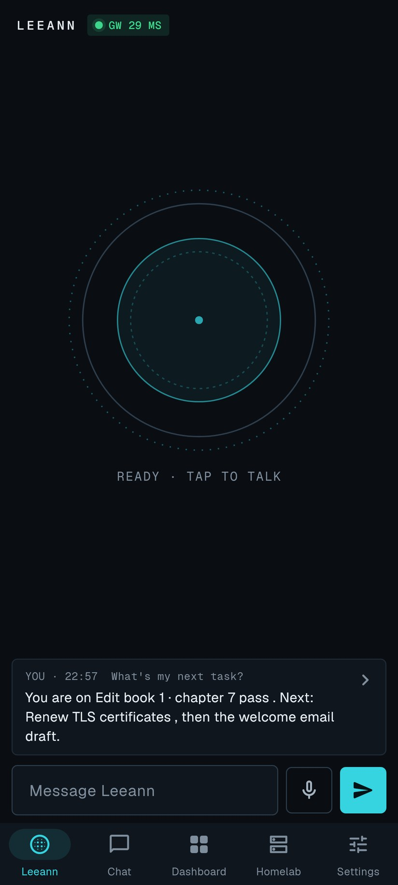

> Screenshots show a demo gateway with invented tasks, mail, hosts, money, health data and conversations.

| Chat | Dashboard | Homelab | Host |
|---|---|---|---|
| 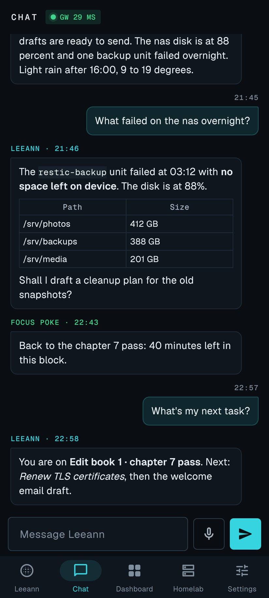 | 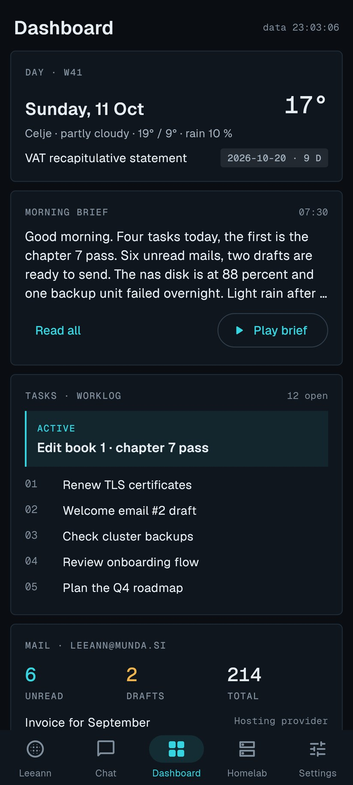 | 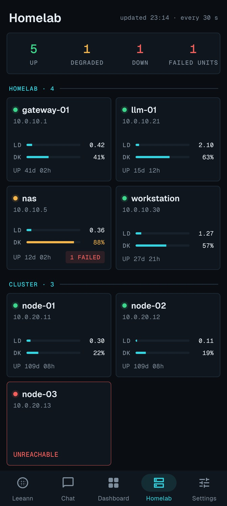 | 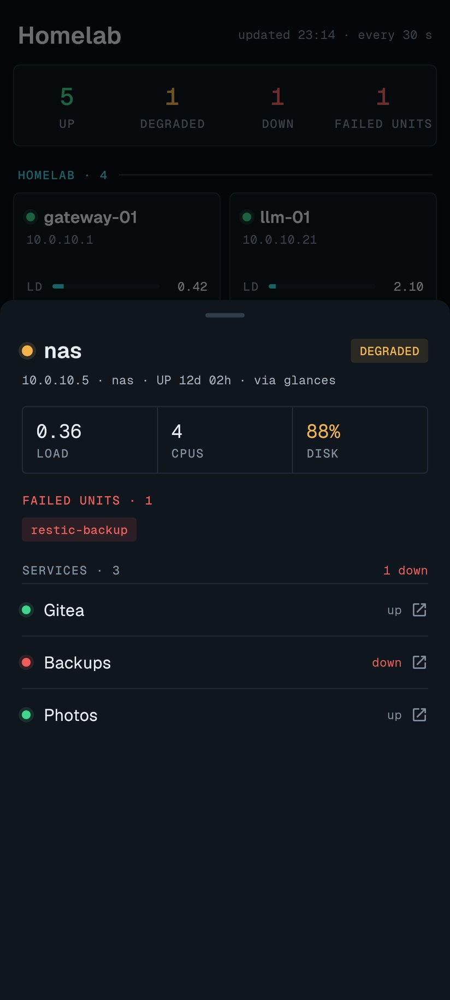 |

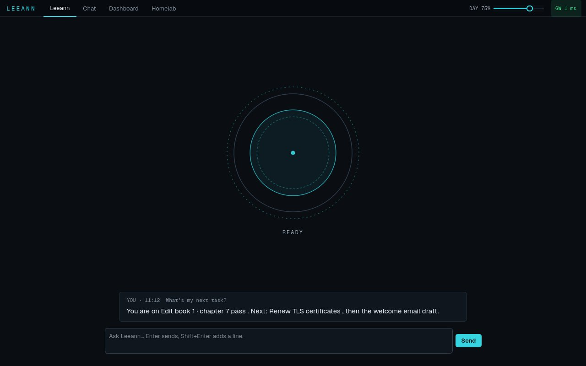

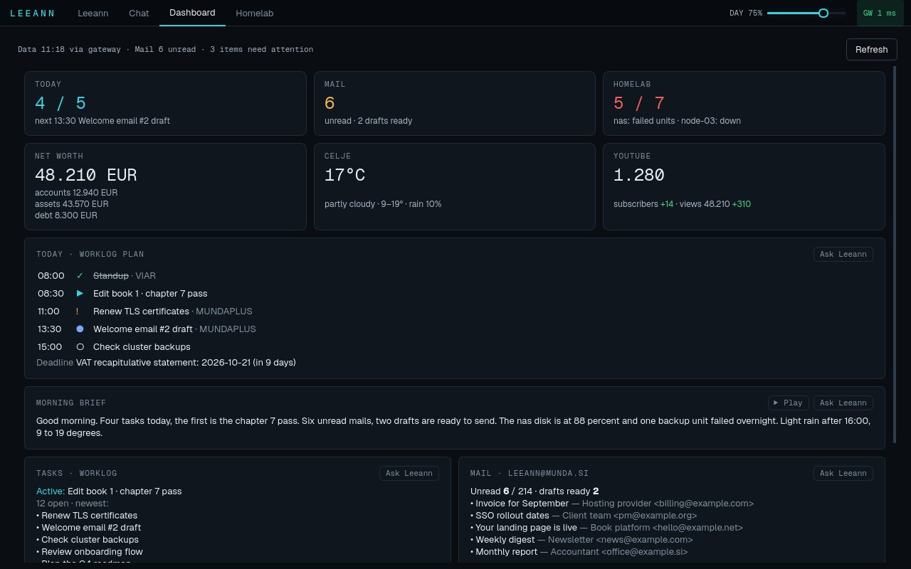

| Desktop homelab | Desktop chat |
|---|---|
| 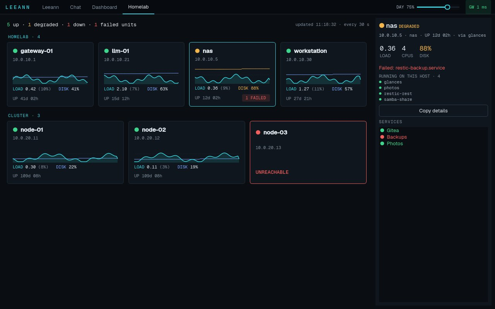 | 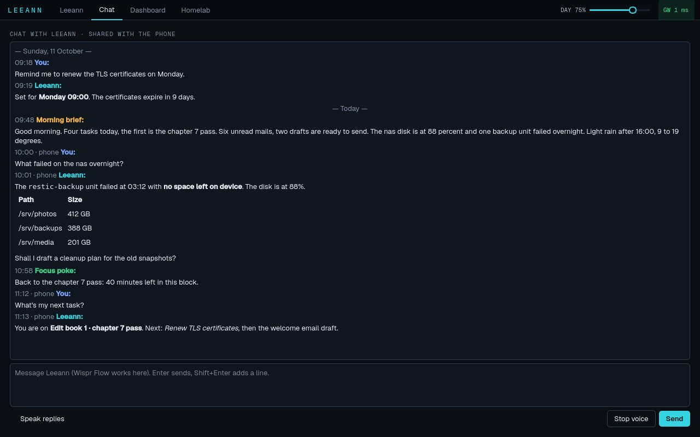 |

| Desktop health | Desktop health, lower part |
|---|---|
| 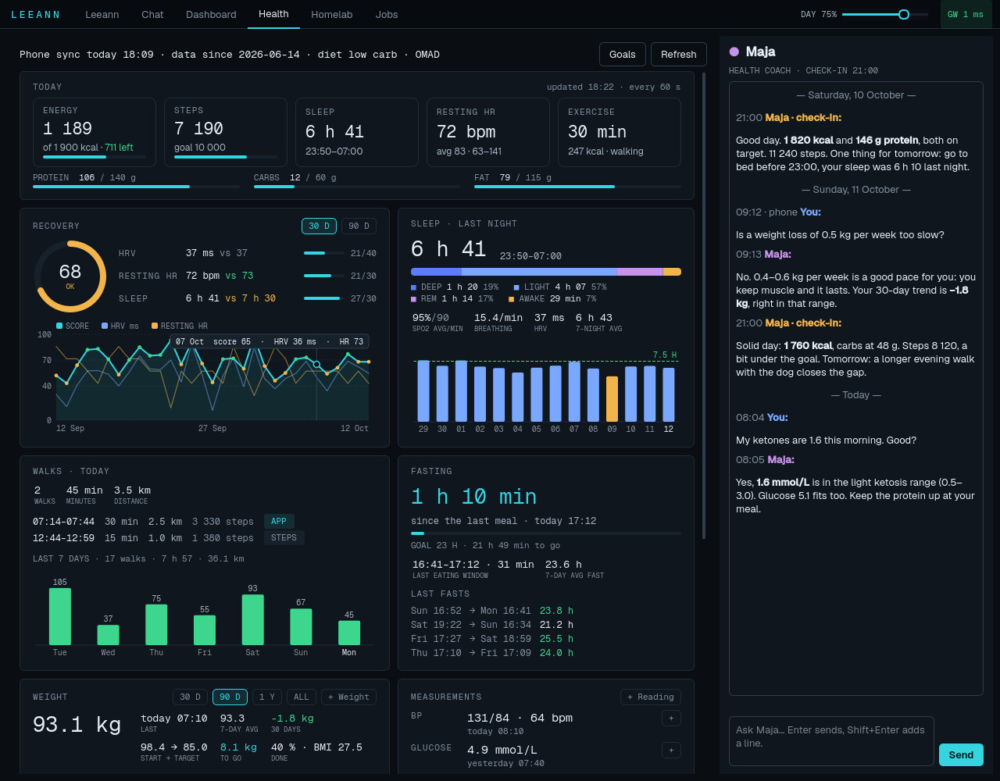 | 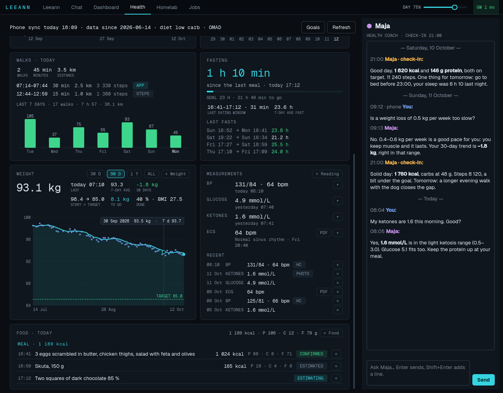 |

## Features

- **One conversation, every device.** The phone and the desktop share a seven-day chat history. A question asked on the phone shows on the desktop within a fraction of a second, and the reverse. Each device speaks only the answers to its own questions. Both apps have the same tabs: Leeann, Chat, Dashboard, Health, Homelab and Jobs.
- **A clean home screen.** The Leeann tab shows a presence orb, the last question and answer, and a prompt. The orb breathes when idle, turns while Leeann thinks and pulses while she speaks. The last exchange fades out after a minute.
- **Hands-free on the phone.** Tap the orb, press a Bluetooth headset button, use the Quick Settings tile or the home screen shortcut, or say "Hey Leeann". A beep confirms, silence ends the turn, and the answer is spoken. The headset microphone is used when one is connected. A setting picks which headset gesture starts Leeann. Other presses still control music and video.
- **On-device voice.** Kokoro text-to-speech and streaming speech recognition run on the phone with sherpa-onnx. The wake word uses keyword spotting. Long answers are spoken sentence by sentence while the next part is generated. Numbers, units and symbols are read as words ("128/82 mmHg" becomes "128 over 82"). Leeann pauses other media while she speaks and lets it continue after. The desktop listens for short spoken answers too.
- **Commands without a round trip.** "Brief", "next task", "homelab status", "mail", "stop", "repeat", "louder" and "softer" are answered on the phone from live data. Everything else goes to Leeann.
- **Dashboard.** The day with weather and deadlines, today's plan from the task tracker, the morning brief, mail, company task boards and releases, open features and bugs of a client platform, net worth and a music channel. Each card has "Ask Leeann". The same data shows on both apps.
- **Morning brief and focus pokes.** A brief each morning lists the tasks planned for the day, the board tasks, the weather and one line on sleep and steps. Short focus pokes during work hours keep the active task in view.
- **Homelab view.** Hosts grouped like a self-hosted homelab dashboard, with load, disk, uptime and failed systemd units. Each host has a 24-hour graph, the services and containers that run on it, and a live up/down check.
- **Homelab alerts and network scan.** A scheduled check reports a host that is down, new failed units and full disks. A nightly scan of the home network reports new machines and open ports.
- **Notifications that keep secrets.** Briefs, focus pokes, mail questions, alerts and answers arrive as notifications with generic text only ("New brief from Leeann"). The content stays in the app.
- **Day and night volume.** Separate volumes for day and night, on both devices.
- **Offline behaviour.** The desktop falls back to direct access when the gateway is down. The phone shows a clear offline banner and keeps the last data.

## Presence-aware voice

Leeann knows where her user is and picks the device that speaks.

- A desk camera on a small home device reports when he sits at the desk.
- The phone reports the Wi-Fi network, walking and whether headphones are connected.
- The gateway turns this into one state: desk, home, work, walking, out or unknown.
- Briefs, pokes and questions are spoken into the phone's headphones when they are connected. Else the desktop speaks at the desk or at home. Elsewhere nobody speaks and the phone only notifies.
- Both apps show the state as a small chip. Leeann gets it as one line of context with each chat.

## Mail review

Leeann asks about important new mail, one mail at a time, in the chat. A "yes" creates a task in the next free work slot of a self-hosted task tracker. A "no" is remembered, and she never asks again. Before she creates a task, she checks for a similar open task or one that is already done. She can also link the mail to an existing task. The answer can be typed or spoken.

## Meetings

Meetings become searchable context for Leeann.

1. **Record.** The desktop records the microphone and the desktop sound into one audio track. The phone records in-person meetings and uploads them through the gateway. A crash loses nothing: both apps save the recording as it runs. Leeann does not speak while a recording runs.
2. **Transcribe.** A watcher finds each new recording. It transcribes it with Whisper (faster-whisper) on a local GPU, in Slovenian or English.
3. **Recap.** The local language model classifies the meeting by account, writes an English recap and suggests tasks. When it is not sure, Leeann asks in the chat.
4. **File.** The transcript, the recap and the audio go to a Meetings page in the task tracker. Suggested tasks wait there to be accepted or dismissed.

Leeann uses the recaps as context when she answers task questions. Old recordings are processed at night, only when the GPU is idle.

## Jobs tab

The Jobs tab on both apps shows the work that runs on a schedule.

- **Meeting watcher.** State, the current file with its step and progress, and the queue. Buttons pause and resume the watcher, start the backlog or run one recording now.
- **Scheduled jobs.** The agent's own scheduled jobs and those of each persona, with schedule, last and next run. Buttons pause, resume or run a job now.
- **Timers.** systemd timers on the servers, grouped by host, read only.
- **Recorder.** A Record card on top starts and stops a meeting recording, with a timer and level meters.

More scheduled jobs offload routine work. They watch the other jobs, digest operations mail and task board activity, sweep overdue tasks, follow up on meetings, prepare a weekly review and a draft monthly report, prepare upcoming meetings, plan quarterly updates, remind of tax filing deadlines, collect invoices and sort sales leads. Each job only reads. Its report arrives in the chat, and a short answer such as "archive ops" or "1 done, 2 move thu" applies the change.

The desktop chat takes file attachments: images, PDFs and text files, by drag and drop, the file dialog or a pasted screenshot.

## Health and coach Maja

The Health tab collects the data that the phone's Health Connect gets from wearables and device apps. It keeps everything without a time limit, so long trends stay visible.

- **Today.** Energy eaten against the goal, protein, carbs and fat, steps, sleep, resting heart rate and exercise.
- **Recovery.** A daily score from heart rate variability, resting heart rate and sleep, against a 30-day baseline.
- **Sleep.** Sleep stages for the last two weeks. A tap on a night opens the night view: hypnogram, heart rate, HRV, blood oxygen, breathing, skin temperature and movement on one time axis, with zoom and the numbers of the night.
- **Walks and steps.** Walks from workout sessions and from step records, with short breaks kept inside one walk.
- **Fasting.** A fasting timer for intermittent fasting and one meal a day (OMAD), with the last fasts.
- **Weight and measurements.** A weight chart with the trend and the goal. Blood pressure, glucose and ketones from Health Connect, from manual entry or from a photo of the meter. ECG results are read from the PDF report of a handheld ECG device: share the PDF to the app, and the values fill in.
- **Food log.** Log food as text, a meal photo, a package label photo, a barcode or a search. Local vision and text models estimate the values. A label without a nutrition table gets an estimate. An unknown food opens a form, and "my foods" learns it.
- **Coach Maja.** A chat with a health coach persona inside the tab, and one check-in each evening.

Photos and PDFs are read by local models. Barcode and food searches are the one exception: they look up the product in Open Food Facts. Only the barcode or the search words leave the home network.

## Personas

Leeann is the front door. She hands work to personas with their own memory and files:

- **Vera** for personal finance.
- **Nika** for the finance, deadlines and paperwork of the own company.
- **Lara** for sales and marketing.
- **Zala**, a senior developer, for code review and release readiness checks.
- **Tina** for his day job. Her memory never mixes with the own company.
- **Maja**, the health coach.

All personas run on local models through Ollama: qwen3.6:35b for chat and tools, a coder model for Zala and a vision model for photos.

## Tech stack

Hermes Agent (Nous Research) · Ollama · local LLMs (qwen3.6, qwen3-vl, qwen3-coder) · Python · FastAPI · SQLite · Server-Sent Events · PyQt6 · Flutter · sherpa-onnx (Kokoro TTS, streaming Zipformer ASR, keyword spotting) · faster-whisper · Health Connect · Open Food Facts · ffmpeg · audio_service · WorkManager · systemd · Docker · Tailscale

## How it works

```
Android app (Flutter) ──┐                              ┌── Hermes agent + personas (local LLMs)
  on-device TTS + ASR   │                              ├── status collector (mail, boards, finance, …)
  Health Connect sync   ├── Tailscale / LAN ── Gateway ┼── homelab layout + live host checks
  meeting recorder      │     device tokens   (FastAPI)├── cron output (brief, pokes, mail review, alerts)
Desktop tray (PyQt6) ───┘                              ├── presence (desk camera, phone context)
  meeting recorder                                     ├── health + food (local vision and text models)
                                                       ├── jobs (meeting watcher, scheduled jobs, timers)
                                                       └── SQLite: shared chat, health data, recordings

Meeting watcher (desktop PC) ── Whisper on a local GPU ── recap ── task tracker Meetings page
```

A small gateway sits between the apps and the agent. It holds the agent's API key, so the apps only ever hold a per-device token. It caches the dashboard data and merges the homelab layout with live host checks. It streams answers as Server-Sent Events. It pushes new messages, briefs, pokes, mail questions, health updates, job changes and presence to every open app. It stores the health data and the coach chat. It takes phone recordings until the meeting watcher fetches them.

## Design principles

- **The home network is the cloud.** Language models, data and history stay on the home server. Speech stays on the phone. Only public lookups (weather, food products) go out.
- **Least privilege.** The apps never see the agent's key. Device tokens are stored as hashes and can be revoked one by one. The apps change nothing on the servers except a few jobs. They can pause, resume and start the meeting watcher. They can pause, resume and run the scheduled jobs of the agent and its personas. Each action goes through the gateway. The gateway accepts only known job ids and file names. Server timers are read only.
- **Quiet logs.** The gateway logs paths, status codes and timings. It never logs message text, health values, food text or tokens.
- **The desktop and the phone stay in sync.** Each feature comes to both apps, with the same data and the same rules.
- **One microphone user at a time.** The wake word, dictation, talk turns and the meeting recorder hand the microphone to each other, so the headset button stays a media button.

## Availability

Copyright (c) 2026 MUNDA PLUS d.o.o. All rights reserved. See [LICENSE](LICENSE).

Licensing enquiries: https://www.munda.si/#contact
